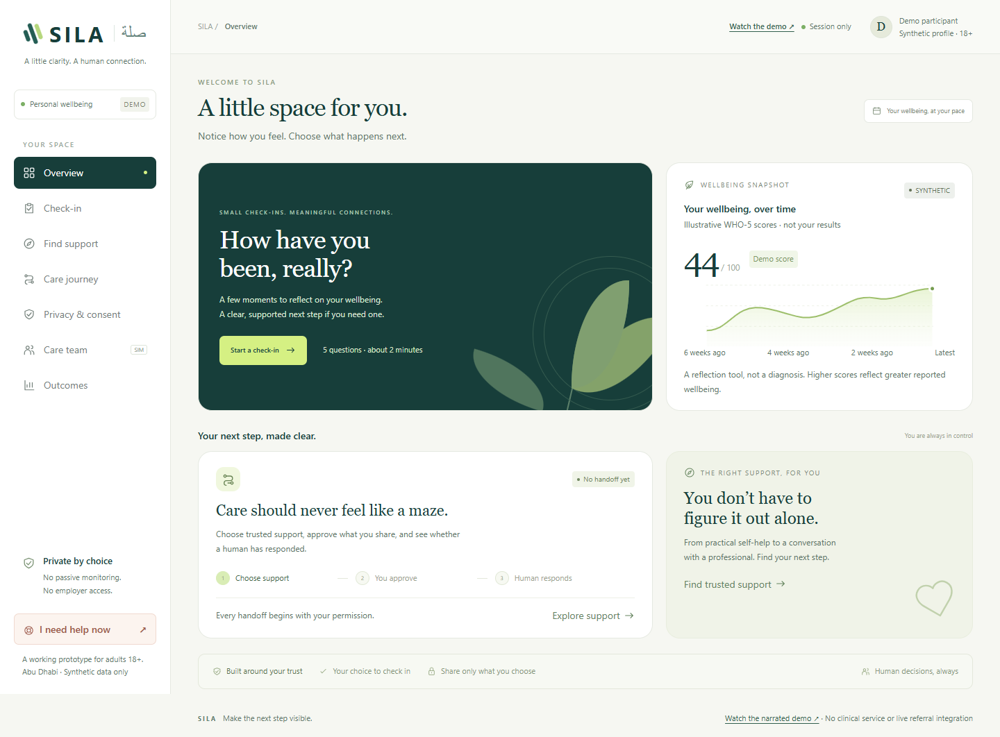

# SILA

### Make the next step visible.

A working prototype for **Earlier, Safer Mental Wellbeing Support**, Future Health Digital Innovation Challenge. SILA connects an opt-in wellbeing check-in to a consent-controlled referral receipt, so a person can see whether a human accepted, declined, or redirected their request.

**[Open the prototype](https://sila-wellbeing-demo.vividdaisy16.chatgpt.site) · [Watch the narrated demo](https://sila-wellbeing-demo.vividdaisy16.chatgpt.site/demo.html)**

> Adult 18+ demonstration with synthetic records. Every care-team action is simulated. SILA does not diagnose, deliver treatment, contact emergency services, or connect to a live clinic.



## What works

- Five-question WHO-5 check-in with transparent scoring and non-diagnostic interpretation.
- A support directory with official Abu Dhabi links and preference-based navigation.
- Granular approval of the score, access needs and optional physical-health context shared in a simulated handoff.
- A patient receipt and mock care-team inbox: accept, decline, re-route, confirm contact and withdraw.
- An always-available urgent-help view with official UAE emergency guidance and an explicit statement that no service has been contacted.
- Session-based consent controls and illustrative outcome/fairness monitoring.

## Try the complete journey

1. Open **Check-in**, read the adult demo scope and answer the five questions.
2. Review the result. A lower WHO-5 score suggests professional assessment; any score can lead to support.
3. Open **Find support** and choose a route. Real service links open the provider's website; prototype handoffs remain simulated.
4. Review each data category before sending the mock request.
5. Switch to **Care team** and decline the referral. Return to **Care journey**, choose an alternative, then simulate acceptance and confirmed human contact.
6. Open **Privacy & consent** and withdraw sharing. Inspect how the available mock payload changes.

## Run locally

Node.js 22 or newer; no application dependencies or API keys.

```sh
npm start
# http://127.0.0.1:4173
npm test
npm run check
```

Static assets are in `dist/`. The same application can be hosted on any static web server. The Sites deployment manifest is specific to the linked hosted demo; remove its project identity before creating an unrelated deployment.

## Implementation and evidence

The current build is a static browser prototype with in-memory state. Switching between the participant and care-team views demonstrates a workflow; it does **not** implement authenticated roles, secure multi-user storage, a tamper-proof audit log, a staffed crisis response or healthcare integration. Do not enter real health information.

The routing logic is deterministic and explainable. No LLM, passive monitoring, hidden suicide classifier, employer dashboard or automated treatment decision is used. A licensed professional must remain responsible for clinical decisions in any future pilot.

See [architecture](docs/ARCHITECTURE.md), [safety boundaries](docs/SAFETY.md), [evaluation definitions](docs/EVALUATION.md), and [sources and repository review](docs/EVIDENCE.md). The reviewed repositories include [Medplum](https://github.com/medplum/medplum), [SMART on FHIR](https://github.com/smart-on-fhir/client-js), [NIH LForms](https://github.com/LHNCBC/lforms), [Microsoft FHIR Converter](https://github.com/microsoft/FHIR-Converter) and [OpenEMR](https://github.com/openemr/openemr). These are future integration references; their code is not represented as incorporated.

## Validation

The Node test suite checks all WHO-5 score totals, missing-input rejection, consent minimisation, referral failure/re-route transitions, withdrawal, distinction between acknowledgement and human contact, missing-outcome handling, urgent-disclosure precedence and small-cohort suppression. Browser walkthroughs cover the actual interface. Synthetic tests cannot establish clinical effectiveness or fairness in a population.

## Rights

Original application code: MIT. WHO-5 instrument content: WHO (2024), **CC BY-NC-SA 3.0 IGO**, separately licensed. The WHO logo is not used and WHO endorsement is not implied. Commercial use of the instrument requires the appropriate rights review. Read [third-party notices](THIRD_PARTY_NOTICES.md).
