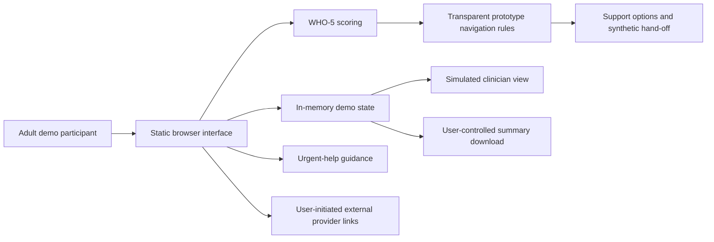

# SILA architecture

SILA is a static browser prototype. Original front-end code demonstrates wellbeing assessment, local support navigation, consented context sharing and a synthetic human-review workflow. It has no application server, patient database, production authentication, live clinician service or EHR connection.

## Current system

The scoring module sums five completed 0–5 responses, giving a raw score from 0 to 25 and a percentage score equal to the raw score multiplied by four. Missing responses must not silently become zero. Score interpretation and navigation rules are separate: the instrument's suggested threshold is sourced; any follow-up priority or timing authored for the demo is illustrative and requires clinical review.

Urgent-help guidance is available independently of scoring. Explicit safety disclosures drive the urgent flow; SILA does not infer suicide risk from sentiment, passive data or a machine-learning classifier. No action in this path contacts a real responder.

## Data and control boundaries

| Boundary | Current behavior and limitation |
|---|---|
| Browser state | Fictional check-ins, preferences, consent choices and simulated workflow state live in memory. They are not durable patient records. Reloading resets the demo. |
| Consent | UI choices illustrate granular sharing and revocation within the current session. There is no server enforcement or remote revocation. |
| Clinician view | A demo persona displays synthetic care context and workflow states. It is not authenticated clinical access or a staffed service. |
| Outcome view | Illustrative records and calculations demonstrate measurement concepts. They are not observed clinical outcomes. |
| Provider navigation | External links point to official directories or provider services. Booking, availability and eligibility must be confirmed externally. No referral API is connected. |
| Downloads | A deliberate download exports a user-controlled summary outside browser state. It does not transmit a referral or prove delivery. |
| Hosting | Static hosting serves public assets. It may log ordinary HTTP metadata. No application health-data endpoint is implemented. |

There is no background sensor collection, employer interface or hidden monitoring. Avoid entering real identifiers or sensitive health information into this public demonstration. The absence of a server does not itself constitute production security or privacy certification.

## Demonstrated flow

1. The person enters an adult demonstration and chooses the context they wish to share.
2. They complete the official WHO-5 or use a clearly labelled synthetic example. Results explain the two-week timeframe and non-diagnostic boundary.
3. Transparent navigation presents self-directed resources, primary care and specialist routes according to the demonstration scenario and personal preferences.
4. The person previews selected mental and physical health context before a simulated hand-off or a summary download.
5. A synthetic clinician persona illustrates human review and workflow progression. A real receiving service is not contacted.
6. Illustrative measures show how acknowledged contact, follow-up and safety completion could be measured in a future pilot.

This is an intended workflow demonstration. It does not claim to close a real care gap, reduce waiting times or improve symptoms.

## Intended future backend

A future supervised pilot could evaluate [Medplum](https://github.com/medplum/medplum) as a FHIR backend and [SMART on FHIR client-js](https://github.com/smart-on-fhir/client-js) for authorized integration. Neither is incorporated or deployed in this prototype.

Possible future resources include Questionnaire/QuestionnaireResponse for check-ins, Observation for derived scores, Consent for sharing permissions, Task and ServiceRequest for monitored hand-offs, and Provenance/AuditEvent for traceability. These are proposed mappings; no local EHR or national health platform has approved or connected them.

The future server must validate every request, authenticate actors, enforce consent and authorization, minimize identifiable content, track receiving-provider acknowledgement and retain an auditable status history. A browser flag must never grant clinical access or establish consent on the server. Integrations require agreements, security review, validated mappings and operational ownership.

See [SAFETY.md](SAFETY.md) for deployment gates, [EVALUATION.md](EVALUATION.md) for measurement definitions and [EVIDENCE.md](EVIDENCE.md) for sources and reference repositories.
